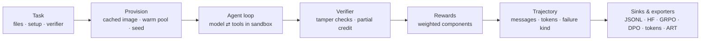

<div align="center">

# AgentBox

**Docker sandboxes, tools, rewards and trajectories for RL post-training of LLM agents.**
Trainer-agnostic: plug it into TRL, verl, OpenRLHF, SkyRL or ART, or drive it from your own loop.

[Quick start](#quick-start) ·
[Training](#train-with-your-rl-framework) ·
[CLI](#cli) ·
[Concepts](#concepts) ·
[Docs](docs/index.md) ·
[Development](#development)


</div>

```bash
pip install agentbox-rl
```

AgentBox owns everything an agentic RL run needs *outside* the trainer: an
isolated Docker sandbox per episode, a tool set the model drives through the
OpenAI tool-calling protocol, a tamper-resistant verifier that turns the final
workspace into a reward, and a trajectory record with **exact token ids and
sampler logprobs** for the training step. Your trainer keeps generation and
optimisation.

## Highlights

- **Correct rewards.** Verifiers run tests in the sandbox after the episode.
  Hidden tests, protected files and planted-`conftest.py` detection stop reward
  hacking. Partial credit is supported (`pytest_fraction`, stdout scores, custom
  functions), and composable reward components cover penalties, LLM judges and
  your own functions.
- **Infra failures are not reward 0.** Every rollout carries a `failure_kind`.
  Sandbox, seeding, model-API and verifier failures are retried and excluded
  from training data instead of skewing GRPO advantages.
- **Exact token data for RL.** Captured token ids and logprobs (vLLM
  `return_token_ids`) are stored compactly per turn. **TITO** (token-in/token-out)
  mode generates from token ids, so each trajectory is *one* prefix-consistent
  sequence with no chat-template re-rendering drift.
- **Trainer adapters.** TRL `environment_factory`, a verl `AgentLoop`, an
  OpenRLHF agent executor, a SkyRL text env and ART `TrajectoryGroup`s, all
  over the same sandboxes, tools and rewards.
- **Built for throughput.** One shared Docker client and bounded thread pools,
  streaming exec with head+tail output caps, cached pytest and setup-snapshot
  images, an optional warm container pool, streaming JSONL storage and online
  metrics. Memory stays flat at thousands of rollouts.
- **Hardened by default.** `cap_drop=ALL`, `no-new-privileges`, an init process,
  PID/memory/CPU limits, no network, a path jail and an optional gVisor runtime.
- **A full CLI.** Run rollouts with resume, inspect, filter, replay, diff and
  export trajectories, author and check tasks, benchmark models with pass@k and
  paired statistics, serve sandboxes over HTTP, and launch TRL training.

## Quick start

Needs Python 3.11+ and a running Docker daemon.

```bash
agentbox doctor                         # Python, Docker, image, caches, integrations
agentbox init                           # agentbox.yaml + tasks/example_add
agentbox run tasks --mock -n 2          # pipeline smoke test, no model needed
```

Point a profile at any OpenAI-compatible server (vLLM, SGLang, Ollama, OpenAI,
OpenRouter, ...) in `agentbox.yaml`, then run a GRPO-style group per task:

```yaml
default_model: local
models:
  local:
    model: Qwen/Qwen3-1.7B
    base_url: http://localhost:8000/v1      # vllm serve Qwen/Qwen3-1.7B --enable-auto-tool-choice --tool-call-parser hermes
    api_key: ${VLLM_API_KEY:-EMPTY}
    capture_tokens: true                    # token ids + logprobs for training
    capture_logprobs: true
sandbox:
  limits: {cpu_count: 1.0, memory_mb: 1024, network_disabled: true}
agent:
  tools: structured
  max_steps: 30
```

```bash
agentbox run tasks -n 8 --out runs/qwen          # 8 samples per task, streamed to runs/qwen
agentbox traj stats runs/qwen                    # success, reward std, zero-variance groups
agentbox traj show runs/qwen                     # one rollout: verifier output, tool calls
agentbox traj export runs/qwen -f grpo -o grpo.jsonl --drop-zero-variance
```

The same thing from Python:

```python
import asyncio
from agentbox import ModelConfig, Rollout, Task, VerifierSpec

task = Task(
    task_id="fix_add",
    description="add(a, b) in calc.py returns the wrong value. Fix it.",
    starter_files={
        "calc.py": "def add(a, b):\n    return a - b\n",
        "test_calc.py": "from calc import add\n\ndef test_add():\n    assert add(2, 3) == 5\n",
    },
    verifier=VerifierSpec(type="pytest", protected_paths=["test_*.py"]),
)
model = ModelConfig(model="Qwen/Qwen3-1.7B", base_url="http://localhost:8000/v1", api_key="EMPTY")

traj = asyncio.run(Rollout.run(task, model=model))
print(traj.final_status, traj.reward, traj.failure_kind, traj.metrics.steps)
```

## Train with your RL framework

| Trainer | Entry point | Guide |
| --- | --- | --- |
| TRL (GRPO) | `agentbox.integrations.trl.make_environment_factory` | [docs/integrations/trl.md](docs/integrations/trl.md) |
| verl | `agentbox.integrations.verl.AgentBoxAgentLoop` | [docs/integrations/verl.md](docs/integrations/verl.md) |
| OpenRLHF | `agentbox.integrations.openrlhf` (`--agent_func_path`) | [docs/integrations/openrlhf.md](docs/integrations/openrlhf.md) |
| SkyRL | `agentbox.integrations.skyrl.AgentBoxTextEnv` | [docs/integrations/skyrl.md](docs/integrations/skyrl.md) |
| ART | `agentbox.integrations.art.to_art_groups` | [docs/integrations/art.md](docs/integrations/art.md) |
| Your own loop | `agentbox.AgentBoxEnv` (reset / step / evaluate) | [docs/training.md](docs/training.md) |

TRL in a few lines (also scaffolded by `agentbox init --trainer trl`, or run
directly with `agentbox train trl tasks/`):

```python
from trl import GRPOConfig, GRPOTrainer
from agentbox import iter_tasks
from agentbox.integrations.trl import make_environment_factory, tasks_to_dataset

tasks = list(iter_tasks("tasks/"))
trainer = GRPOTrainer(
    model="Qwen/Qwen3-0.6B",
    train_dataset=tasks_to_dataset(tasks),
    environment_factory=make_environment_factory(tasks),   # one sandbox per rollout
    args=GRPOConfig(num_generations=8, max_tool_calling_iterations=8,
                    chat_template_kwargs={"enable_thinking": False}),
)
trainer.train()
```

A trainer-driven loop with the environment API:

```python
from agentbox import AgentBoxEnv

env = AgentBoxEnv()
obs = await env.reset(task)                   # obs.messages, obs.tools (OpenAI schemas)
while True:
    reply = await my_policy(obs.messages, obs.tools)  # text, message dict or tool calls
    step = await env.step(reply)
    if step.done:
        break
result = await env.evaluate()                 # verifier + reward components
traj = env.trajectory()                       # same schema as Rollout / CLI runs
await env.close()
```

Sandboxes can also live on other machines: `agentbox serve` exposes the same
API over HTTP and `agentbox.env.remote.RemoteEnv` is the client
([docs/server.md](docs/server.md)).

## CLI

```text
agentbox run        rollouts for task files/dirs/datasets; resume, groups, TITO, rewards
agentbox traj       show · stats · filter · validate · replay · render · export · diff
agentbox task       new · validate · lint · check · show · ls · schema
agentbox bench      create · freeze · validate · run · show · compare
agentbox sandbox    up · exec · shell · ls · rm · prune
agentbox cache      ls · prune · warm        agentbox image  build · ls
agentbox generate   one · batch · validate-llm · validate-docker
agentbox train      trl                      agentbox serve  (HTTP environments)
agentbox config     show · validate · path   agentbox doctor · integrations · init
```

Global options: `--config/-C`, `--profile/-P`, `--json` (machine-readable output
on every command), `-v/-vv`, `--log-format json`. Exit codes: `0` ok, `1` task
failures or thresholds not met, `2` usage/config errors, `3` Docker or model
endpoint unavailable. Full reference: [docs/cli-reference.md](docs/cli-reference.md).

## Concepts



| Concept | What it is |
| --- | --- |
| **Task** | Starter files, setup commands, a verifier, optional per-task environment ([tasks](docs/tasks.md)) |
| **Sandbox** | A fresh, hardened container per rollout, never reused ([sandbox](docs/sandbox.md)) |
| **Tools** | `list_files`, `read_file`, `write_file`, `edit_file`, `run_command`, `run_tests`, plus `search_files`, `apply_patch`, `submit` and your own `@tool`s ([tools](docs/tools.md)) |
| **Agent loop** | Native OpenAI tool calls or the Hermes text protocol; ordered tool execution; deadlines; context-length handling ([agent](docs/agent.md)) |
| **Reward** | Verifier reward plus weighted components (`step_penalty`, `llm_judge`, `module:fn`, ...) ([rewards](docs/rewards.md)) |
| **Trajectory** | Schema v2: messages, tool records, verifier result, reward breakdown, failure kind, token data ([trajectories](docs/trajectories.md)) |
| **Runner** | Streaming, bounded-memory parallel rollouts with groups, retries and resume ([runner](docs/runner.md)) |

## Documentation

Start at [docs/index.md](docs/index.md). Key pages: [quick start](docs/quickstart.md) ·
[configuration](docs/configuration.md) · [training](docs/training.md) ·
[models & TITO](docs/models.md) · [performance](docs/performance.md) ·
[security](docs/security.md) · [benchmarks](docs/benchmarks.md) ·
[migrating from 0.2](docs/migration.md).

## Development

```bash
uv pip install -e ".[dev]"
pytest tests/unit -q                      # no Docker needed
pytest tests/integration -m docker -q     # real sandboxes
ruff check . && ruff format --check . && mypy src
python scripts/gen_reference_docs.py      # regenerate CLI/config references
```

Commits follow [Conventional Commits](https://www.conventionalcommits.org/). See
[docs/development.md](docs/development.md).

## License

Apache License 2.0. See [LICENSE](LICENSE).
