**AgentBox gives agentic RL real worlds to learn in.** Every rollout gets a
fresh, hardened Docker sandbox, and the agent works in it through tools. A
verifier that is hard to game turns the final workspace into a reward, and the
episode is recorded with the exact tokens your trainer needs. TRL, verl,
OpenRLHF, SkyRL and ART plug in through thin adapters, and so does your own
loop.
[](https://github.com/konic-labs/agentbox/actions/workflows/ci.yml) [](https://pypi.org/project/agentbox-rl/)



## Why AgentBox

| | |
| --- | --- |
| **One world per attempt** | A fresh container per rollout, never reused. No network, capabilities dropped, no new privileges, PID, memory and CPU limits, and a path jail. A warm pool hides the start-up time. |
| **Rewards you can trust** | The verifier runs after the agent, with hidden tests, restored test files and detection of planted `conftest.py` files. Partial credit and weighted reward components are built in. |
| **Infrastructure is not reward 0** | Sandbox, seeding, model-API and verifier failures carry a `failure_kind`. They are retried, and never become a fake negative advantage. |
| **Exact tokens** | Sampled token ids and logprobs are captured for every turn. Token-in/token-out keeps each episode one prefix-consistent sequence. |
| **Any trainer** | Adapters for TRL, verl, OpenRLHF, SkyRL and ART, a step-wise environment API, and an HTTP server for sandboxes on other machines. |
| **Flat memory, fast I/O** | Streaming rollouts with bounded output, cached images and setup snapshots: thousands of rollouts in tens of megabytes. |

## Quick start

AgentBox needs Python 3.11+ and a running Docker daemon.

```bash
pip install agentbox-rl
agentbox doctor                 # Python, Docker, image, caches, integrations
agentbox init                   # agentbox.yaml + tasks/example_add
agentbox run tasks --mock -n 2  # the whole pipeline, no model needed
```

Point a profile at any OpenAI-compatible server (vLLM, SGLang, Ollama, OpenAI,
OpenRouter and others) in `agentbox.yaml`:

```yaml
default_model: local
models:
  local:
    model: Qwen/Qwen3-1.7B
    base_url: http://localhost:8000/v1      # vllm serve Qwen/Qwen3-1.7B --enable-auto-tool-choice --tool-call-parser hermes
    api_key: ${VLLM_API_KEY:-EMPTY}
    capture_tokens: true                    # token ids and logprobs for training
    capture_logprobs: true
agent:
  tools: structured
  max_steps: 30
```

Then run a GRPO-style group of eight per task, and look at what came back:

```bash
agentbox run tasks -n 8 --out runs/qwen          # streamed to runs/qwen
agentbox traj stats runs/qwen                    # success, reward std, zero-variance groups
agentbox traj show runs/qwen                     # one rollout: verifier output, tool calls
agentbox traj export runs/qwen -f grpo -o grpo.jsonl --drop-zero-variance
```

The same rollout from Python:

```python
import asyncio
from agentbox import ModelConfig, Rollout, Task, VerifierSpec

task = Task(
    task_id="fix_add",
    description="add(a, b) in calc.py returns the wrong value. Fix it.",
    starter_files={
        "calc.py": "def add(a, b):\n    return a - b\n",
        "test_calc.py": "from calc import add\n\ndef test_add():\n    assert add(2, 3) == 5\n",
    },
    verifier=VerifierSpec(type="pytest", protected_paths=["test_*.py"]),
)
model = ModelConfig(model="Qwen/Qwen3-1.7B", base_url="http://localhost:8000/v1", api_key="EMPTY")

traj = asyncio.run(Rollout.run(task, model=model))
print(traj.final_status, traj.reward, traj.failure_kind, traj.metrics.steps)
```

The [quick start](docs/quickstart.md) walks through it.

## Train on one GPU


[`examples/verl`](examples/verl) is a GRPO recipe tested end to end on one L4 (24 GB)
with 4 vCPUs and 15 GB of RAM: Qwen3-0.6B with thinking on, a full fine-tune, and
30 steps of 8 coding tasks × 8 samples at about 2.5 minutes a step. In two runs,
success on 9 held-out tasks rose from 48.6% to 77.8% and 83.3%, and
`agentbox bench compare` found no task worse. The
[verl guide](docs/integrations/verl.md) has the settings a small host needs and
the full numbers.

## Train with your RL framework



| Trainer | Entry point | Guide |
| --- | --- | --- |
| verl | `agentbox.integrations.verl.AgentBoxAgentLoop` | [verl](docs/integrations/verl.md), with the tested single-GPU recipe |
| TRL (GRPO) | `agentbox.integrations.trl.make_environment_factory` | [TRL](docs/integrations/trl.md) |
| OpenRLHF | `agentbox.integrations.openrlhf` (`--agent_func_path`) | [OpenRLHF](docs/integrations/openrlhf.md) |
| SkyRL | `agentbox.integrations.skyrl.AgentBoxTextEnv` | [SkyRL](docs/integrations/skyrl.md) |
| ART | `agentbox.integrations.art.to_art_groups` | [ART](docs/integrations/art.md) |
| Your own loop | `agentbox.AgentBoxEnv` (reset / step / evaluate) | [Training](docs/training.md) |

TRL in a few lines. `agentbox init --trainer trl` scaffolds it, and
`agentbox train trl tasks/` runs it:

```python
from trl import GRPOConfig, GRPOTrainer
from agentbox import iter_tasks
from agentbox.integrations.trl import make_environment_factory, tasks_to_dataset

tasks = list(iter_tasks("tasks/"))
trainer = GRPOTrainer(
    model="Qwen/Qwen3-0.6B",
    train_dataset=tasks_to_dataset(tasks),
    environment_factory=make_environment_factory(tasks),   # one sandbox per rollout
    args=GRPOConfig(num_generations=8, max_tool_calling_iterations=8,
                    chat_template_kwargs={"enable_thinking": False}),
)
trainer.train()
```

Or drive the environment from your own loop:

```python
from agentbox import AgentBoxEnv

env = AgentBoxEnv()
obs = await env.reset(task)                   # obs.messages, obs.tools (OpenAI schemas)
while True:
    reply = await my_policy(obs.messages, obs.tools)  # text, message dict or tool calls
    step = await env.step(reply)
    if step.done:
        break
result = await env.evaluate()                 # verifier and reward components
traj = env.trajectory()                       # same schema as Rollout and CLI runs
await env.close()
```

Sandboxes can also live on other machines: `agentbox serve` exposes the same
API over HTTP, and `agentbox.env.remote.RemoteEnv` is the client
([server](docs/server.md)).

## CLI

```text
agentbox run        rollouts for task files/dirs/datasets; resume, groups, TITO, rewards
agentbox traj       show · stats · filter · validate · replay · render · export · diff
agentbox task       new · validate · lint · check · show · ls · schema
agentbox bench      create · freeze · validate · run · show · compare
agentbox sandbox    up · exec · shell · ls · rm · prune
agentbox cache      ls · prune · warm        agentbox image  build · ls
agentbox generate   one · batch · validate-llm · validate-docker
agentbox train      trl                      agentbox serve  (HTTP environments)
agentbox config     show · validate · path   agentbox doctor · integrations · init
```

Every command takes `--config/-C`, `--profile/-P`, `--json` (machine-readable
output), `-v/-vv` and `--log-format json`. Exit codes: `0` ok, `1` task
failures or unmet thresholds, `2` usage or configuration errors, `3` Docker or
the model endpoint unavailable. The [CLI reference](docs/cli-reference.md) has
every option.

## Concepts


| Concept | What it is |
| --- | --- |
| **Task** | Starter files, setup commands, a verifier and an optional per-task environment ([tasks](docs/tasks.md)) |
| **Sandbox** | A fresh, hardened container per rollout, never reused ([sandbox](docs/sandbox.md)) |
| **Tools** | `list_files`, `read_file`, `write_file`, `edit_file`, `run_command`, `run_tests`, plus `search_files`, `apply_patch`, `submit` and your own `@tool`s ([tools](docs/tools.md)) |
| **Agent loop** | Native OpenAI tool calls or the Hermes text protocol, ordered tool execution, deadlines and context-length handling ([agent](docs/agent.md)) |
| **Reward** | The verifier's reward plus weighted components such as `step_penalty`, `llm_judge` or any `module:fn` ([rewards](docs/rewards.md)) |
| **Trajectory** | Schema v2: messages, tool records, verifier result, reward breakdown, failure kind and token data ([trajectories](docs/trajectories.md)) |
| **Runner** | Streaming, bounded-memory parallel rollouts with groups, retries and resume ([runner](docs/runner.md)) |

## Documentation

| Start here | Build | Reference |
| --- | --- | --- |
| [Quick start](docs/quickstart.md) | [Tasks](docs/tasks.md) and [rewards](docs/rewards.md) | [CLI reference](docs/cli-reference.md) |
| [Training](docs/training.md) | [Sandbox](docs/sandbox.md) | [Configuration reference](docs/config-reference.md) |
| [Architecture](docs/architecture.md) | [Models and TITO](docs/models.md) | [Benchmarks](docs/benchmarks.md) |
| [Migrating from 0.2](docs/migration.md) | [Performance](docs/performance.md) | [Security](docs/security.md) |

Every page is listed in the [documentation index](docs/index.md).

## Development

```bash
uv pip install -e ".[dev]"
pytest tests/unit -q                      # no Docker needed
pytest tests/integration -m docker -q     # real sandboxes
ruff check . && ruff format --check . && mypy src
python scripts/check_docs.py              # links, anchors and images in the docs
```

Commits follow [Conventional Commits](https://www.conventionalcommits.org/).
[Development](docs/development.md) covers the tests, CI, the reference docs and
the docs images.

## License

Apache License 2.0. See [LICENSE](LICENSE).


