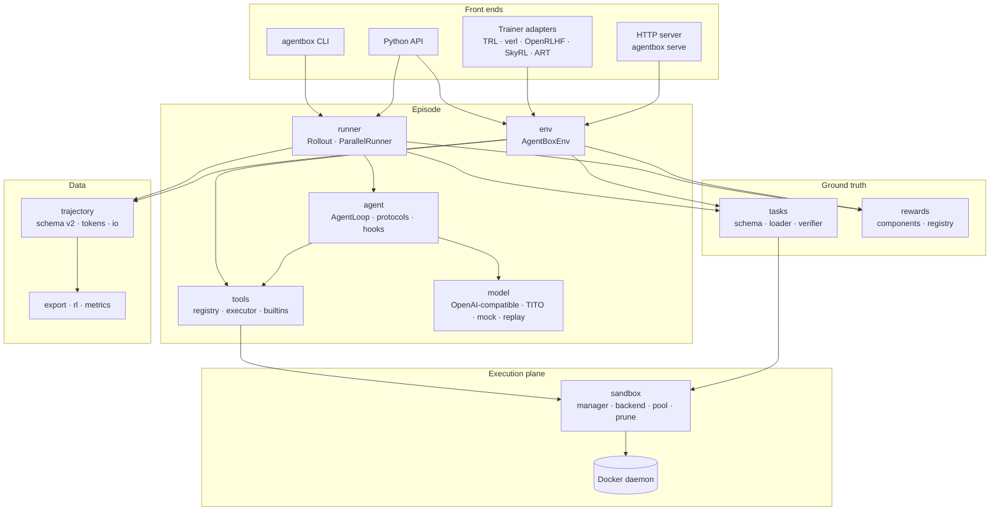

# Architecture

## Layers

Prompts, model calls, trajectories and rewards run on the host (the control
plane). Every file operation, command and test runs inside the container (the
execution plane).

## One rollout

1. **Provision** (`runner/provision.py`). Merge the task's `environment` over
   the run's `SandboxConfig`. Resolve the image: the base image, or a cached
   derived image with pytest installed once per image, or a cached
   *setup snapshot* holding the task's `setup_commands` output. Take a warm-pool
   container or create one, then seed the starter files with a single tar
   upload. Failures raise `ProvisionError(kind)` (`sandbox`, `seed`,
   `setup_check`).
2. **Agent loop** (`agent/loop.py`). Alternate model turns and tool calls until
   a final answer, `submit`, `max_steps`, the episode deadline or context
   exhaustion. Tool calls run in emission order; consecutive read-only calls may
   run concurrently. Every call gets a tool message, even on timeout.
3. **Verify** (`tasks/verifier.py`). Restore protected files, write hidden
   files, remove forbidden new files (planted `conftest.py`, ...), then run the
   verifier command with a hardened environment. Parse the exit code, JUnit XML
   (`pytest_fraction`) or stdout score.
4. **Reward** (`rewards.py`). Weighted sum of components (`verifier`,
   `step_penalty`, `llm_judge`, `module:function`, ...), with the per-component
   breakdown kept on the trajectory.
5. **Record** (`trajectory/`). A schema-v2 `Trajectory`: messages (with per-turn
   token data when captured), tool-call records, verifier result, reward and
   breakdown, `final_status`, `stop_reason`, `failure_kind`, and timings.
6. **Release.** Remove the container, or keep it with `keep_on_failure` (its
   name is recorded as `metadata.kept_sandbox`).

`AgentBoxEnv` exposes the same steps one at a time (`reset` = provision,
`step`/`call_tool` = tools, `evaluate` = verify + reward, `trajectory` =
record) for trainers that own generation.

## Package map

| Package | Responsibility |
| --- | --- |
| `sandbox/` | `DockerBackend` (shared client, bounded daemon thread pools, streaming exec with output caps, kill-on-timeout, image cache, derived images), `SandboxManager` (per-config lifecycle and file I/O), `pool.py` (warm pool), `prune.py`, `images.py` (presets) |
| `tools/` | `BaseTool`, `@tool`, registry and modes, `ToolExecutor` (ordering, timeouts, truncation, records), builtins |
| `agent/` | `AgentLoop`, `Conversation` (incremental wire payload), Hermes protocol, `AgentHooks`, prompts |
| `model/` | `OpenAICompatClient` (typed retries, context-length handling, token capture), mock/function/replay clients, endpoint probes |
| `tito.py` | Token-in/token-out generation (`TitoModelClient`, `ChatTokenizer`, `CompletionsGenerator`) |
| `tasks/` | Task schema v2, loaders (dirs, JSON, JSONL(.gz), Parquet), seeder, verifier, filters, generation pipeline |
| `rewards.py` | `RewardSpec`, reward registry, built-in components |
| `runner/` | `Rollout.run`, `ParallelRunner` (stream, stream_groups, run_to_sink), provisioning, retries |
| `env/` | `AgentBoxEnv`, `SyncAgentBoxEnv`, `RemoteEnv` |
| `trajectory/` | Schema v2, token traces, sinks and readers, HTML rendering |
| `export/` | Exporter registry: chat, sharegpt, dpo, grpo, tokens, hf, art |
| `rl/` | pass@k, group advantages (GRPO, Dr. GRPO, RLOO), zero-variance groups |
| `metrics/` | Streaming `MetricsAccumulator` |
| `integrations/` | TRL, verl, OpenRLHF, SkyRL, ART adapters (imported only when used) |
| `benchmark/` | Suites, content hashes, runner, reports, paired comparison |
| `server/` | FastAPI environment server |
| `cli/` | Typer application |

## Concurrency model

- **One Docker client per process.** `get_backend()` returns a shared
  `DockerBackend`. Its connection pool matches its two thread pools: an **I/O**
  pool (default 128 threads) for blocking exec streams and archive transfers,
  and a **control** pool (default 16) for create, remove, inspect and kill.
  Both use daemon threads, so a stuck stream can never block interpreter exit.
  Size them with `AGENTBOX_DOCKER_IO_THREADS` / `AGENTBOX_DOCKER_CTL_THREADS`.
- **Kill on timeout.** Every exec carries a unique environment marker. When a
  command times out, its process tree is found by that marker and killed, so the
  thread and the CPU are freed immediately.
- **Bounded output.** Streams are read incrementally into head+tail buffers
  (`max_output_bytes`). A command that exceeds `kill_output_bytes` is killed.
- **Runner backpressure.** `ParallelRunner.stream` runs `concurrency` workers
  over a lazily consumed job iterator and a bounded result queue. Model requests
  can be capped separately with `model_concurrency`.
- **Exit cleanup.** Containers this process created are tracked and removed at
  exit; orphan pruning uses owner labels to spare other processes' sandboxes.

## Invariants

- A container is never handed to two rollouts.
- Tool paths are resolved against the workspace; symlinks are followed only
  inside it.
- Conversations are always valid: no dangling tool calls, and ids match.
- Infrastructure failures never look like policy failures (`failure_kind`).
- Token data, when captured, is exactly what the server sampled.
  `Trajectory.token_trace()` reports prefix breaks instead of hiding them.
