# AgentBox documentation

AgentBox runs LLM agents in isolated Docker sandboxes and turns each episode
into a reward and a training-ready trajectory. It is **trainer-agnostic**: the
trainer (TRL, verl, OpenRLHF, SkyRL, ART or your own loop) owns generation and
optimisation, and AgentBox owns sandboxes, tools, verification, rewards and
trajectory data.

## Start here

| I want to... | Read |
| --- | --- |
| Install, run my first rollouts, see the outputs | [Quick start](quickstart.md) |
| Train a model with TRL / verl / OpenRLHF / SkyRL / ART | [Training](training.md) and the [integration guides](#integrations) |
| Write tasks and verifiers that cannot be gamed | [Tasks](tasks.md), [Rewards](rewards.md) |
| Configure models, sandboxes and the agent | [Configuration](configuration.md) ([full reference](config-reference.md)) |
| Use the command line | [CLI guide](cli.md) ([full reference](cli-reference.md)) |
| Make runs fast and memory-flat | [Performance](performance.md) |
| Upgrade from 0.2 | [Migration](migration.md) |

## Guides

| Page | Covers |
| --- | --- |
| [Quick start](quickstart.md) | Install, `doctor`, `init`, mock and real-model runs, inspecting and exporting |
| [Architecture](architecture.md) | Layers, data flow, concurrency model, invariants |
| [Configuration](configuration.md) | `agentbox.yaml`, profiles, `${VAR}` interpolation, Python config objects |
| [Sandbox](sandbox.md) | Images, limits, security, caches, warm pool, lifecycle, interactive sandboxes |
| [Tasks](tasks.md) | Task schema, verifiers, tamper protection, per-task environments, datasets, authoring |
| [Rewards](rewards.md) | Reward modes, composable components, LLM judges, custom rewards, failure kinds |
| [Agent](agent.md) | The loop, stop reasons, tool protocols (native / Hermes), hooks, prompts |
| [Tools](tools.md) | Builtin tools and modes, custom tools with `@tool`, truncation, timeouts |
| [Models](models.md) | OpenAI-compatible endpoints, retries, reasoning, sampling, token capture, TITO |
| [Runner](runner.md) | `Rollout`, `ParallelRunner`, groups, retries, resume, sinks |
| [Trajectories](trajectories.md) | Schema v2, storage, metrics, trajectory tooling, exporters |
| [Training](training.md) | Environment API, choosing an integration, exact token data, RL utilities |
| [Server](server.md) | `agentbox serve` HTTP environments and the `RemoteEnv` client |
| [Benchmarks](benchmarks.md) | Frozen suites, pass@k, paired comparisons, CI gating |
| [Task generation](generation.md) | Teacher-generated tasks with static, Docker and LLM QC |
| [Performance](performance.md) | Memory and latency design, knobs, measurements |
| [Security](security.md) | Threat model, isolation defaults, reward-hacking defences |
| [Development](development.md) | Tests, CI, docs generation, releasing, extending |

### Integrations

[TRL](integrations/trl.md) · [verl](integrations/verl.md) ·
[OpenRLHF](integrations/openrlhf.md) · [SkyRL](integrations/skyrl.md) ·
[ART](integrations/art.md)

### Reference

[CLI reference](cli-reference.md) and [configuration reference](config-reference.md)
are generated from the code (`python scripts/gen_reference_docs.py`).

## Guarantees

- **Fresh sandbox per rollout.** Containers are never reused across episodes;
  warm-pool containers are handed out once.
- **Tools act only inside the sandbox.** Paths are jailed to the workspace, and
  the host filesystem is never the agent's workspace.
- **The verifier owns the reward.** It runs after the agent, with protected and
  hidden files restored or written first.
- **Infrastructure failures are labelled, not scored.** `failure_kind` tells
  policy failures (train on them) from sandbox, seed, model-API and verifier
  failures (retry and drop them).
- **Trajectories are self-contained.** One JSON object per rollout holds the
  messages, tool records, verifier result, reward breakdown and token data.
- **No conversation is left dangling.** Every assistant tool call gets a tool
  response, even on timeouts and errors.
