# verl

`AgentBoxAgentLoop` subclasses verl's `ToolAgentLoop`. verl keeps full
control of generation and tokenisation (continuous token sequences, no
re-tokenisation drift). AgentBox provisions a sandbox per trajectory, executes
every tool call in it, and sets the trajectory's `reward_score` from the
verifier and reward components.

## Single GPU: a tested recipe

Everything in [`examples/verl/`](../../examples/verl) was run end to end on one
L4 (24 GB) with 4 vCPUs and 15 GB of RAM, using verl 0.9.1, vLLM 0.24 and
torch 2.11 on CUDA 13. The run is GRPO with a full fine-tune of Qwen3-0.6B,
thinking on, over 36 small coding tasks:

```bash
pip install "verl[vllm]==0.9.1" agentbox-rl
python examples/verl/make_coding_tasks.py data/tasks        # 27 train + 9 held-out eval tasks
python examples/verl/prepare_data.py --out data/verl        # verl parquet rows -> agent "agentbox"
STEPS=30 examples/verl/run_grpo_single_gpu.sh               # ~2.5 min per step
```

There are three task families: create a file, fix a bug, and implement a
function from a stub. Every task has protected tests, planted-file detection
and `pytest_fraction` partial credit. Each step trains on 8 tasks × 8 samples,
about 100K tokens.

### Results



The recipe was run twice for 30 steps. Run 2 used the script exactly as
shipped, plus an extra checkpoint at step 15. The reward is the AgentBox
verifier's. Training and validation numbers are verl's own metrics.
Validation covers the 9 held-out tasks with greedy decoding.

| | Run 1 | Run 2 |
| --- | --- | --- |
| Training reward, steps 1–5 → 25–29 (64 samples per step) | 0.56 → 0.82 | 0.57 → 0.86 |
| Validation reward, before training → last validation | 0.59 → 0.85 (step 25) | 0.70 → 0.89 (step 30) |
| Response length in tokens, steps 1–5 → 25–29 | 1005 → 876 | 1021 → 805 |
| Host RAM in use (`perf/cpu_memory_used_gb`) | 12.0 → 12.9 GB | 10.3 → 10.5 GB |
| Time per step | 160 s | 150 s |

Run 1 has no step-30 validation, because it ran out of host RAM after its
final checkpoint save
([#103](https://github.com/konic-labs/agentbox/issues/103)). Run 2 has the
fix. Its saves at steps 15 and 30 each gave their memory back, and it exited
cleanly. The two runs scored 0.59 and 0.70 before training, so read a single
validation point on 9 tasks as ±0.1. The evaluation below has 72 episodes per
model.

The step-30 checkpoints and the base model were evaluated with AgentBox
itself: the held-out tasks as a frozen suite, temperature 0.6, thinking on.

| | Base | Run 1, step 30 | Run 2, step 30 |
| --- | --- | --- | --- |
| Held-out suite: success (9 tasks × 8) | 48.6% | **83.3%** | **77.8%** |
| … create / fix / implement | 32/32 · 0/24 · 3/16 | 32/32 · 13/24 · 15/16 | 32/32 · 11/24 · 13/16 |
| … mean reward | 0.634 | 0.866 | 0.810 |
| Train split: success (27 tasks × 4) | 48.1% | **87.0%** | **85.2%** |
| … create / fix / implement | 44/48 · 3/36 · 5/24 | 44/48 · 29/36 · 21/24 | 44/48 · 26/36 · 22/24 |

`bench compare` pairs runs by task. On the held-out suite, both runs improved
the same 4 tasks and regressed none: +34.7 points for run 1 (95% CI 9.7 to
62.5), and +29.2 for run 2 (6.9 to 54.2). The suite is small and comes from
the training families, so read this as a check that the pipeline learns, not
as a benchmark score.

The trajectories show what changed. The base model often ran the tests and
stopped, or answered in prose without calling a tool (6 of 72 held-out
episodes). Both trained models write the fix: 1.28 and 1.31 `write_file` calls
per episode, up from 0.50. They almost always act (1 and 0 episodes without a
tool call), and they think about a quarter less. Run 1 also stopped running
the tests first (0.19 `run_tests` calls per episode, down from 0.65), while
run 2 kept more of them (0.46).

To repeat the evaluation:

```bash
vllm serve checkpoints/agentbox/global_step_30/actor/huggingface --tokenizer Qwen/Qwen3-0.6B \
  --served-model-name qwen3-0.6b-grpo --enable-auto-tool-choice --tool-call-parser hermes
agentbox bench create suites/eval --from-tasks data/tasks/eval.jsonl --suite-id mini-eval \
  --name "mini eval" --n 8 --tools list_files,read_file,write_file,run_tests --max-steps 6
agentbox bench run suites/eval --models-file models-base.yaml -o bench/base
agentbox bench run suites/eval --models-file models-grpo.yaml -o bench/grpo
agentbox bench compare bench/base/report.json bench/grpo/report.json
```

```yaml
# models-grpo.yaml; models-base.yaml names the base model and its server
models:
  - model_id: policy
    model: qwen3-0.6b-grpo
    base_url: http://localhost:8000/v1
    temperature: 0.6
    top_p: 0.95
    max_tokens: 3072
    extra_body: {chat_template_kwargs: {enable_thinking: true}}
```

Give both models the same `model_id` so `bench compare` pairs them
([benchmarks](../benchmarks.md)). Start one vLLM server at a time
on a shared GPU. vLLM sizes its KV cache from the memory it sees free at
start-up, so a server that starts while another is still allocating gets a
negative budget.

### Settings that matter on a small host

| Problem | Setting |
| --- | --- |
| verl's v1 trainer starts TransferQueue storage units (8 × ~0.4 GB of host RAM) | `trainer.use_v1=False`, the legacy trainer, which verl 0.9.1 still ships but marks as deprecated |
| Every Ray actor costs host RAM; 15 GB is tight | `actor_rollout_ref.rollout.agent.num_workers=1`, `reward.num_workers=1`, `+ray_kwargs.ray_init.include_dashboard=False`, `+ray_kwargs.ray_init.object_store_memory=1500000000`, `RAY_memory_usage_threshold=0.97` |
| A checkpoint save builds full fp32 state dicts on the CPU. glibc keeps the freed heap (~2.5 GB) in the worker, and the validation that follows runs out of host RAM | `MALLOC_MMAP_THRESHOLD_=1048576`. It also lowered host RAM in use from 12.0–12.9 GB to 10.3–10.5 GB, with no slowdown |
| Ray schedules one logical CPU per actor | `ray_kwargs.ray_init.num_cpus=16` on a 4-vCPU box |
| No flash-attn wheel for torch 2.11 / CUDA 13 | `actor_rollout_ref.model.use_remove_padding=False`, `+actor_rollout_ref.model.override_config.attn_implementation=sdpa` |
| Without padding removal, fp32 logits over a 152K vocabulary exhaust the GPU | `actor_rollout_ref.model.use_fused_kernels=True`, `PYTORCH_CUDA_ALLOC_CONF=expandable_segments:True`, `ppo_max_token_len_per_gpu=8192` |
| Padded rows cost compute, so size the budgets to the data | `data.max_prompt_length=1024`, `data.max_response_length=3072` (observed: prompts ~640 tokens, responses up to ~2.4K) |
| verl's default tool response budget (256 tokens) cuts pytest output | `actor_rollout_ref.rollout.multi_turn.max_tool_response_length=1024` |
| The rollout defaults to tensor parallel 2 | `actor_rollout_ref.rollout.tensor_model_parallel_size=1` |
| Metrics are block-buffered under Ray | `PYTHONUNBUFFERED=1` |

verl stops its workers with SIGKILL at the end of a run, so their exit handlers
never run. The next AgentBox process removes the sandboxes they left behind
([sandbox lifecycle](../sandbox.md#lifecycle-and-cleanup)), and
`agentbox sandbox prune` does it on demand.

## Multi-GPU

The same pieces scale out. Multi-GPU and multi-node runs are not validated
yet; [#98](https://github.com/konic-labs/agentbox/issues/98) tracks that.

### 1. Dataset

```python
from agentbox import AgentConfig, iter_tasks
from agentbox.integrations.verl import write_verl_parquet

agent = AgentConfig(tools=["list_files", "read_file", "write_file", "run_tests"])
write_verl_parquet(iter_tasks("tasks/", split="train"), "data/train.parquet", agent=agent)
write_verl_parquet(iter_tasks("tasks/", split="eval"), "data/val.parquet", agent=agent)
```

Each row routes to the `agentbox` agent loop (`agent_name`). It carries the
user prompt and a system prompt rendered for the agent's tools, and embeds the
task as JSON in `extra_info.agentbox_task`. For large datasets, pass
`embed_task=False` to keep only `extra_info.task_id`, and point
`$AGENTBOX_TASKS` at the task source so workers can resolve the ids.

### 2. Register the agent loop

```yaml
# agent_loops.yaml
- name: agentbox
  _target_: agentbox.integrations.verl.AgentBoxAgentLoop
```

### 3. Sandbox, agent and reward settings

Workers read `$AGENTBOX_VERL_CONFIG` (YAML or JSON), which has the same
sections as `agentbox.yaml`
([example](../../examples/verl/agentbox-verl.yaml)). Use the same tools as
the dataset's system prompt. Tool schemas come from AgentBox, not from verl's
`tool_config_path`.

### 4. Train

Start from
[`run_grpo_single_gpu.sh`](../../examples/verl/run_grpo_single_gpu.sh), then
raise `trainer.n_gpus_per_node`, the rollout's tensor parallel size, the batch
size and the number of agent-loop workers. The memory-saving settings above
are only needed on small hosts. `multi_turn.format`,
`multi_turn.max_assistant_turns` and `agent.agent_loop_config_path` are read
by verl's agent-loop code, and these switches have moved between verl
releases. Check the multi-turn example of your version.

## Behaviour

- `reward_score` is the AgentBox reward. `extra_fields["agentbox"]` holds
  `success`, `status`, `failure_kind`, `reward_breakdown` and `infra_failure`.
- verl has no notion of an unscorable sample. For infrastructure failures (the
  sandbox could not be provisioned, or the verifier crashed), the adapter zeroes
  the sample's `response_mask`, so its tokens contribute no gradient, and flags
  it in `extra_fields`. A provisioning failure does not crash the agent loop:
  tool calls return an error, and the batch continues.
- Tool calls run in AgentBox's sandbox with AgentBox's timeouts, output caps and
  path jail. verl's `max_tool_response_length` truncation still applies to what
  goes back into the token sequence.
- verl parses tool calls with its own strict Hermes parser. It drops malformed
  calls, and the turn ends. AgentBox's tool-call salvage applies only to its
  own agent loop.
