# Sandbox

Every rollout runs in its own Docker container, created from a
`SandboxConfig`, seeded with the task's files, and removed afterwards.
Containers are never reused across rollouts.



## Images

| Preset | Image |
| --- | --- |
| `python` (default) | `python:3.12-slim-bookworm` |
| `python3.11` / `python3.13` | `python:3.11-slim-bookworm` / `python:3.13-slim-bookworm` |
| `node` | `node:22-bookworm-slim` |
| `go` | `golang:1.24-bookworm` |
| `rust` | `rust:1-slim-bookworm` |
| `baked` | `agentbox/sandbox:latest` (see below) |

```python
from agentbox.sandbox.images import register_preset, sandbox_config_for_preset

cfg = sandbox_config_for_preset("node", limits={"memory_mb": 2048})
register_preset("myorg", "registry.example.com/agent-sandbox:2026.10")
```

Any image works if it can run the container command (`sleep infinity` by
default). On first use AgentBox probes each image once for `bash`, `python` and
`pytest`. String commands then run with `bash -c` when bash exists and
`sh -c` otherwise; override this with `SandboxConfig.shell`.

**Baked image.** `agentbox image build` builds `agentbox/sandbox:latest` from
the Dockerfile shipped in the package (bash, coreutils, git, patch, procps,
pytest on `python:3.12-slim-bookworm`). Use `--base` to start from another
image, `--dockerfile` to use your own, and `agentbox image ls` to list images
usable as sandboxes.

## Cached derived images

Two kinds of work that every rollout of an image (or a task) would otherwise
repeat are done once and committed into cached images named
`agentbox-cache:<key>`:

- **pytest.** With `ensure_pytest=True` (default) and an image that has Python
  but not pytest, pytest is installed once per base image.
- **Setup snapshots.** With `cache_setup=True` (default), a task's
  `setup_commands` run once on top of its seeded files. Later rollouts of that
  task start from the snapshot and skip both seeding and setup.

The key hashes the base image id, the commands, the seeded files, the
environment and the network setting, so any change produces a new image.
Concurrent requests for the same key are single-flight. The cache is an LRU
bounded by `cache_max_images` (default 64), and images still in use are never
removed. Builds may use the network (`prepare_network=True`) even when sandboxes
run without it.

```bash
agentbox cache warm tasks/ -c 8     # build every task's setup snapshot before training
agentbox cache ls                   # cached images: tag, size, age
agentbox cache prune --older-than-h 48
```

## Resources and security defaults

| Setting | Default | Field |
| --- | --- | --- |
| CPUs | 1.0 | `limits.cpu_count` |
| Memory | 512 MiB, no swap | `limits.memory_mb`, `limits.memswap_mb` |
| Processes | 256 | `limits.pids_limit` |
| Network | none | `limits.network_disabled` |
| Open files, `/dev/shm`, read-only root, tmpfs | unset | `limits.nofile`, `shm_size_mb`, `read_only_rootfs`, `tmpfs` |
| Capabilities | drop `ALL`, add back CHOWN, DAC_OVERRIDE, FOWNER, FSETID, KILL, SETGID, SETUID, NET_BIND_SERVICE | `security.cap_drop`, `security.cap_add` |
| Privilege escalation | blocked (`no-new-privileges`) | `security.no_new_privileges` |
| PID 1 | init process (reaps zombies) | `security.init` |
| User | image default | `security.user` |
| OCI runtime | Docker default (`runsc` for gVisor) | `security.runtime` |

See [security](security.md) for the threat model.

## Commands and output

`SandboxManager.exec` (and the `run_command` / `run_tests` tools) stream
stdout and stderr and keep a bounded **head + tail** of each stream
(`max_output_bytes`, 256 KiB by default). A command whose output passes
`kill_output_bytes` (64 MiB) is killed. On timeout the command's whole process
tree is killed. `ExecResult` reports what happened through `timed_out`,
`killed`, `stdout_truncated`, `stderr_truncated` and `output_bytes`. The agent sees `max_tool_output_chars` of each tool result (head +
tail).

## Warm pool

Creating and starting a container takes roughly 0.2–0.5 s on a busy host, on
every rollout's critical path. With `warm_pool: K`, AgentBox keeps up to K
started, never-used containers per sandbox *shape* (image, limits, security,
environment, workspace) and hands each to exactly one rollout:

```yaml
sandbox:
  warm_pool: 4
  warm_pool_ttl_s: 300
```

```bash
agentbox run tasks -n 8 -c 16 --warm-pool 4
```

- Refills are demand-driven: a shape is warmed only after it was requested, or
  through `SandboxManager.warm(n)`.
- Idle containers expire after `warm_pool_ttl_s`. At most 8 shapes are kept
  (LRU), and background creations are bounded.
- A miss that arrives while a container of its shape is being created waits for
  it instead of starting a second create.
- Pooled containers carry `agentbox.pool=1` and no task/run labels, because
  Docker labels are immutable. Orphan pruning still covers them; pruning by
  `--run-id` does not.

Measured with 64 rollouts at concurrency 8 on a 4-vCPU host: time to the first
model call fell from 0.31 s to 0.04 s at the median, and wall clock went from
16.6 s to 14.8 s ([performance](performance.md)).

## Host-wide cap

Distributed trainers run one AgentBox process per worker: verl agent-loop
workers, OpenRLHF vLLM engines, TRL ranks. A per-process limit multiplies with
the number of workers, and a large GRPO batch starts every rollout at once.
`host_max_sandboxes` bounds the sandboxes in use on a host, counted across
every AgentBox process on it:

```yaml
sandbox:
  warm_pool: 8
  host_max_sandboxes: 64     # all workers on this node together
  host_slot_timeout_s: 1800  # then provisioning fails as an infra error
```

- The cap is a directory of lock files in `/dev/shm` (`$AGENTBOX_SLOTS_DIR`),
  one namespace per Docker daemon. A sandbox holds a lock from provisioning
  until it is removed. The kernel releases the lock when its process dies, so
  a SIGKILLed worker never keeps a slot.
- Rollouts that find no free slot wait in FIFO order. The wait is recorded as
  `metrics.sandbox_wait_s`.
- Idle warm-pool containers are not counted: they hold no CPU time and only
  their memory limit. The containers on a node stay below
  `host_max_sandboxes + workers × warm_pool`.
- A trainer that holds every sandbox of a batch until the batch ends (TRL
  provisions all of a step's environments first) needs a cap at least as large
  as its per-node batch. A smaller cap waits for `host_slot_timeout_s` and
  then fails those rollouts as infra failures.

With 256 rollouts per step on two GPUs, a cap of 64 kept the node at 64
sandboxes in use ([verl](integrations/verl.md#throughput)).

## Lifecycle and cleanup

- `auto_remove` (default true) removes each sandbox after its rollout.
- `keep_on_failure` keeps the sandboxes of rollouts that did not succeed.
  Kept containers are renamed `<name>-kept`. The name is recorded as
  `metadata.kept_sandbox`, and `agentbox traj show` prints it together with
  the command to open a shell.
- Containers created by a process are tracked and removed when it exits.
- **Sandboxes die with their owner** (`die_with_owner`, on by default). The
  process that creates a sandbox holds its stdin open through an attach
  stream, and the container's main process watches it. When the owner dies,
  however it dies, the kernel closes the stream, the daemon closes stdin, and
  the container exits and is removed (`AutoRemove`). Ray SIGKILLs trainer
  workers at the end of every verl, OpenRLHF and SkyRL run: a process holding
  68 sandboxes, in use and pooled, left none 0.25 s after its SIGKILL, and a
  verl run on two GPUs left none without any prune. Creating a sandbox is no
  slower (68 ms at the median either way).
  - The image needs `/bin/sh`. The configured `command` still runs, in the
    background, and kept sandboxes (`keep_on_failure`, `sandbox up`) are told
    to stay before their owner lets go.
  - Each bound sandbox holds one file descriptor in its owner: 200 sandboxes
    in one process held 221 in all. Raise `ulimit -n` for a few hundred.
  - A process forked after creating sandboxes lets go of its copies of the
    streams, so the sandboxes stay tied to the process that created them.
  - Image builders and probes, which last seconds and are committed into
    cached images, are not bound.
- Orphan reaping covers the rest: containers from before this setting, or
  with `die_with_owner: false`, or created by a process that died before it
  attached. The first process to use Docker afterwards removes, in the
  background, the containers of dead processes on this host. Live processes'
  containers and kept sandboxes are never touched. Set
  `AGENTBOX_REAP_ORPHANS=0` to disable this.
- `agentbox sandbox prune` does the same on demand
  (`python -m agentbox sandbox prune` where the venv's scripts are not on
  `PATH`). On a Ray cluster, `--ray-address auto` runs the prune on every
  node, because each node judges the owner labels against its own processes.
  The example launch scripts still run it after training, as a fallback. It
  connects as any Ray client: where `ray start` turned on token
  authentication (the default in Ray 2.59), set `RAY_AUTH_MODE=token`, as
  your training jobs do.
- Every container is labelled `agentbox=1`, `agentbox.owner=<host:pid>`,
  `agentbox.created`, `agentbox.role`, and per rollout `agentbox.task_id`,
  `agentbox.run_id`, `agentbox.rollout_id` and `agentbox.group_id`. The owner
  is the process that created the sandbox, a forked child included.

```bash
agentbox sandbox ls                    # owner, age, orphan status (-a: builders and probes too)
agentbox sandbox prune                 # orphans only: owner process is gone (kept sandboxes stay)
agentbox sandbox prune --ray-address auto   # orphans on every node of a Ray cluster
agentbox sandbox prune --run-id RUN    # one run's sandboxes
agentbox sandbox prune --older-than 2h --dry-run
agentbox sandbox prune --all           # every AgentBox container
```

## Interactive sandboxes

Debug a task by hand in the exact environment rollouts get:

```bash
agentbox sandbox up tasks/example_add          # seeds the task, prints the container name
agentbox sandbox exec NAME -- python -m pytest -q
agentbox sandbox shell NAME                    # docker exec -it ... bash/sh
agentbox sandbox rm NAME
```

## Per-task environments

A task can override the run's sandbox settings:

```json
{
  "task_id": "node_lint_001",
  "environment": {
    "image": "node:22-bookworm-slim",
    "env": {"CI": "1"},
    "network": false,
    "memory_mb": 2048,
    "working_dir": "/app",
    "ensure_pytest": false
  }
}
```

Each distinct environment gets its own manager, cache keys and warm-pool shape.

## Python API

```python
from agentbox import SandboxConfig, SandboxManager

mgr = SandboxManager(SandboxConfig(ensure_pytest=False))
sb = await mgr.create(task_id="scratch", run_id="dev")
await mgr.write_files(sb, {"hello.py": "print('hi')\n"})
res = await mgr.exec(sb, "python hello.py", timeout_s=10)
print(res.exit_code, res.stdout, res.timed_out, res.stdout_truncated)
print(await mgr.list_dir(sb, ".", recursive=True))
data = await mgr.read_bytes(sb, "hello.py")      # bounded, symlink-safe
await mgr.destroy(sb)
```

Managers are cheap: they share the process-wide `DockerBackend` (one Docker
client, bounded thread pools). Create one per configuration.
